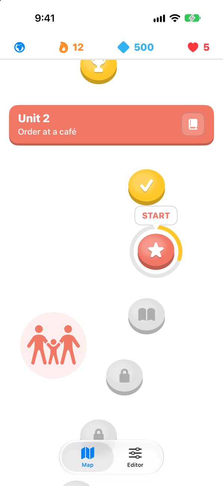
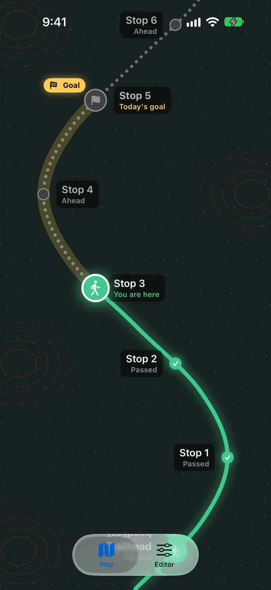
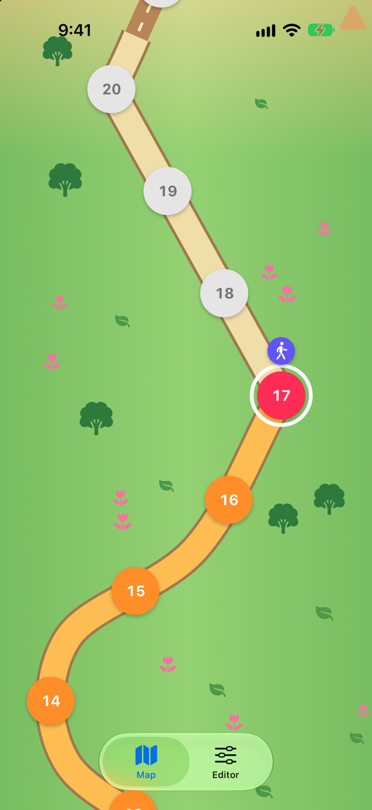
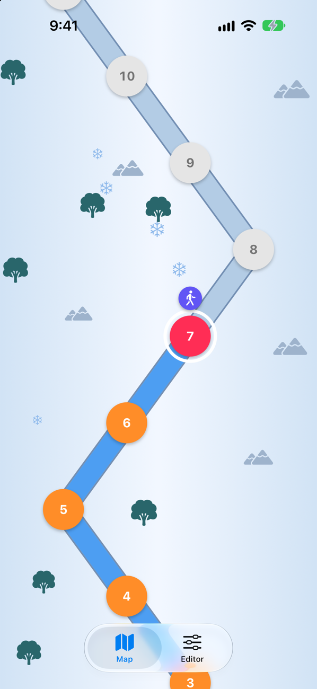

# LevelMap

A scrolling, game-style level map for SwiftUI. You build the road in code from segments instead
of drawing it as an SVG. It can show thousands of levels, or never end.

<p>
  
  &nbsp;
  
</p>

## Examples

Every map below is a `LevelMap` from the demo app. Only the route, the theme, the node views and
the layers change.

<p>
  
  
  
  
</p>

| Sample | Shows | Launch with |
| --- | --- | --- |
| Lessons | No road, unit banners in a full-width layer, illustrations placed by `placement(ofLevel:)` | `-sample Lessons -current 10` |
| Trail | Dotted road with glow, labels by side, goal pennant, follow camera | `-sample Trail -current 3` |
| World | Endless serpentine with chapters and theme transitions | `-sample World -look Chapters -current 16` |
| Zigzag | Built-in `.zigzag` route with the snow theme | `-sample Zigzag -look Snow -current 6` |

## Features

- **Routes in code.** Put segments together with a result builder: `Straight`, `Serpentine`,
  `Zigzag`, `Detour`, `Spline`, `Polyline` and your own. End the route in `Repeat` and the map
  never ends.
- **Fits every screen.** The road is laid out again for each width, and levels are spread evenly
  along it.
- **Fast at any level.** The map is built in chunks only when they come near the screen, so
  opening on level 5,000 costs the same as opening on level 5.
- **Themes and chapters.** Set the ground, the road style (with an optional shader) and seeded
  scenery that stays clear of the road. Switch to a new theme every chapter.
- **Progress.** Nodes are marked completed, current or locked. The completed road grows and
  your avatar walks to the next level. Reduce Motion is respected.
- **Live progress between levels.** `.levelMapProgress(toNext:)` puts the avatar part of the way
  to the next level, for apps where a level is a real goal, such as a place the user walks to.
- **Accessible.** VoiceOver reads nodes in road order and adds a "Current level" rotor.
- **Vertical or horizontal**, from either end.
- **A visual editor.** `LevelMapEditor` lets you drag the road on a live map, then export it as
  Swift or JSON.

iOS 18, macOS 14 and visionOS 1. Swift 6.

## Installation

Add the package in Xcode with **File › Add Package Dependencies**, or in `Package.swift`:

```swift
.package(url: "https://github.com/Prince2k3/level-map.git", from: "0.4.0"),
```

Then add the `LevelMap` product to your target. If you want the editor, add `LevelMapEditor` to a
debug-only target or screen.

## Quick start

```swift
import LevelMap
import SwiftUI

extension LevelRoute {
    static let forest = LevelRoute {
        Start(x: 0.5)
        Straight(levels: 2)
        Serpentine(levels: 10, amplitude: 0.32)
        Detour(around: .leading, levels: 3)
        Repeat { Serpentine(levels: 6, halfWaves: 2) }
    }
}

struct WorldScreen: View {
    @State private var current = 0

    var body: some View {
        LevelMap(EndlessLevels(), route: .forest, startsAtEnd: true, current: current) { context in
            Text("\(context.index + 1)")
                .frame(width: 52, height: 52)
                .background(Circle().fill(context.state == .locked ? .gray : .orange))
        }
        .levelMapTheme(.plain)
        .levelMapAvatar { Image(systemName: "figure.walk.circle.fill").font(.largeTitle) }
    }
}
```

The content builder receives a `LevelMapNodeContext`: the level's model (`level`), its position
on the road (`index`), its `state` (completed, current or locked) and its `placement` (the side
of the road it sits on, its heading and the layout direction).

To show your own models, pass a collection with an `id:` key path, so each node keeps its
identity when the data changes:

```swift
LevelMap(lessons, id: \.id, route: .serpentine(), current: finished) { context in
    LessonButton(lesson: context.level, state: context.state)
}
.levelMapSpacing(130)
```

## The camera

Without a binding, the map opens on the player and keeps the current level in view until the
person scrolls. Bind a `LevelMapCameraPosition` to frame the map yourself:

```swift
@State private var camera: LevelMapCameraPosition = .automatic

var body: some View {
    LevelMap(stops, id: \.id, route: .serpentine(), current: reached, position: $camera) { context in
        StopPin(stop: context.level, state: context.state)
    }
    .levelMapAvatar { Walker() }
    .levelMapProgress(toNext: walked)
    .levelMapRecenterButton()
}
```

- `.automatic` opens on the player and tracks progress.
- `.level(_:anchor:)` frames any level, including a fractional one, without changing progress.
- `.avatar(zoom:anchor:scalesMarkers:)` zooms in and follows the avatar, for a live walk. Set it
  when the walk starts and `.automatic` when it ends.

When the person scrolls, the map writes a value back whose `positionedByUser` is `true`, and the
camera stays where they left it until you assign a new framing or they tap the recenter button.
Animations you pass with `withAnimation` take precedence over the map's own, and the camera eases
to its new framing when the level count, the content margins or the spacing change.

## Documentation

The DocC catalog has a guide for each part of the library. In Xcode, choose
**Product › Build Documentation**.

- **Quick start:** put a map on screen, mark progress and add a look.
- **Designing routes:** segments, endless routes, custom segments and the editor.
- **Themes and decorations:** ground, road styles, scenery and chapters.
- **Endless maps and paging:** chunks, data sources and level positions.
- **Layers, placement and the camera:** layers, marks, right-to-left placement and camera framing.
- **Moving to the release API:** replacements for the APIs removed in 0.4.0.

## Demo app

`Examples/LevelMapDemo` shows every built-in route on an endless map with three themes and
chapters, plus the editor. Generate the project with [XcodeGen](https://github.com/yonaskolb/XcodeGen):

```bash
cd Examples/LevelMapDemo && xcodegen && open LevelMapDemo.xcodeproj
```

The demo accepts these launch arguments:

- `-sample <World|Wave|Zigzag|Spline|Exported|Trail|Lessons>`
- `-current <level>`, the level to open on
- `-horizontal`
- `-editor`
- `-autoplay`
- `-walk`, which walks towards each level 10 m at a time
- `-walkStep <metres>`, how far each simulated location update walks (10 by default)
- `-look <theme>`, such as `-look Meadow`, to open with that theme
- `-clean`, which hides the demo's controls, for screenshots
- `-uitest`, which shows the probe labels the UI tests read

### UI tests

`LevelMapDemoUITests` drives the demo and checks the map while the avatar walks live: it moves
smoothly towards the next level, Stop freezes it, arriving makes the next level current without
running back, it keeps walking while you scroll away, and it works on every route, horizontally
and top-down. Run them on any iOS 18+ simulator:

```bash
cd Examples/LevelMapDemo && xcodegen && xcodebuild test -project LevelMapDemo.xcodeproj -scheme LevelMapDemo -destination "platform=iOS Simulator,name=iPhone 17"
```

With `-uitest` the demo adds two labels for the tests: `avatarProbe`, the avatar's centre as
`x,y`, and `avatarGap`, as `level:points`, the distance from the avatar to the current level's
node. The suite takes about five minutes.
