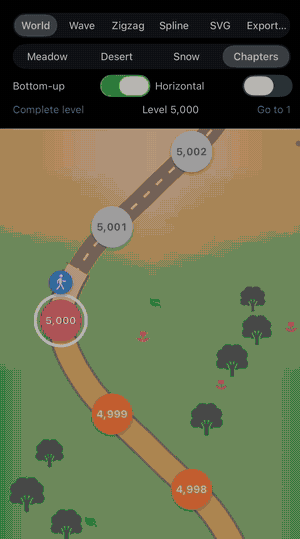
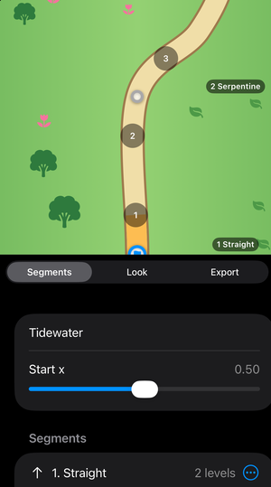

# LevelMap

A scrolling, game-style level map for SwiftUI. You build the road in code from segments instead
of drawing it as an SVG. It can show thousands of levels, or never end.

<p>
  
  &nbsp;
  
</p>

## Features

- **Routes in code.** Put segments together with a result builder: `Straight`, `Serpentine`,
  `Zigzag`, `Detour`, `Spline`, `Polyline` and your own. End the route in `Repeat` and the map
  never ends.
- **Fits every screen.** The road is laid out again for each width, and levels are spread evenly
  along it.
- **Fast at any level.** The map is built in chunks only when they come near the screen, so
  opening on level 5,000 costs the same as opening on level 5.
- **Themes and chapters.** Set the ground, the road style (with an optional shader) and seeded
  scenery that stays clear of the road. Switch to a new theme every chapter.
- **Progress.** Nodes are marked completed, current or locked. The completed road grows and
  your avatar walks to the next level. Reduce Motion is respected.
- **Live progress between levels.** `.levelMapProgress(toNext:)` puts the avatar part of the way
  to the next level, for apps where a level is a real goal, such as a place the user walks to.
- **Accessible.** VoiceOver reads nodes in road order and adds a "Current level" rotor.
- **Vertical or horizontal**, from either end.
- **A visual editor.** `LevelMapEditor` lets you drag the road on a live map, then export it as
  Swift or JSON.

iOS 17, macOS 14 and visionOS 1. Swift 6.

## Installation

Add the package in Xcode with **File › Add Package Dependencies…**, or in `Package.swift`:

```swift
.package(url: "https://github.com/<you>/level-map.git", from: "0.1.0"),
```

Then add the `LevelMap` product to your target. If you want the editor, add `LevelMapEditor` to a
debug-only target or screen.

## Quick start

```swift
import LevelMap
import SwiftUI

extension LevelRoute {
    static let forest = LevelRoute {
        Start(x: 0.5)
        Straight(levels: 2)
        Serpentine(levels: 10, amplitude: 0.32)
        Detour(around: .leading, levels: 3)
        Repeat { Serpentine(levels: 6, halfWaves: 2) }
    }
}

struct WorldScreen: View {
    @State private var current = 0

    var body: some View {
        LevelMap(EndlessLevels(), route: .forest, startsAtEnd: true, current: current) { _, index, state in
            Text("\(index + 1)")
                .frame(width: 52, height: 52)
                .background(Circle().fill(state == .locked ? .gray : .orange))
        }
        .levelMapTheme(.plain)
        .levelMapAvatar { Image(systemName: "figure.walk.circle.fill").font(.largeTitle) }
    }
}
```

## Documentation

The DocC catalog has a guide for each part of the library. In Xcode, choose
**Product › Build Documentation**.

- **Quick start:** put a map on screen, mark progress and add a look.
- **Designing routes:** segments, endless routes, custom segments and the editor.
- **Themes and decorations:** ground, road styles, scenery and chapters.
- **Endless maps and paging:** chunks, data sources and level positions.

## Demo app

`Examples/LevelMapDemo` shows every built-in route on an endless map with three themes and
chapters, plus the editor. Generate the project with [XcodeGen](https://github.com/yonaskolb/XcodeGen):

```bash
cd Examples/LevelMapDemo && xcodegen && open LevelMapDemo.xcodeproj
```

The demo accepts these launch arguments:

- `-sample <World|Wave|Zigzag|Spline|Exported>`
- `-horizontal`
- `-editor`
- `-autoplay`
- `-walk`, which walks towards each level 10 m at a time
- `-walkStep <metres>`, how far each simulated location update walks (10 by default)
- `-look <theme>`, such as `-look Meadow`, to open with that theme
- `-uitest`, which shows the probe labels the UI tests read

### UI tests

`LevelMapDemoUITests` drives the demo and checks the map while the avatar walks live: it moves
smoothly towards the next level, Stop freezes it, arriving makes the next level current without
running back, it keeps walking while you scroll away, and it works on every route, horizontally
and top-down. Run them on any iOS 17+ simulator:

```bash
cd Examples/LevelMapDemo && xcodegen && xcodebuild test -project LevelMapDemo.xcodeproj -scheme LevelMapDemo -destination "platform=iOS Simulator,name=iPhone 17"
```

With `-uitest` the demo adds two labels for the tests: `avatarProbe`, the avatar's centre as
`x,y`, and `avatarGap`, as `level:points`, the distance from the avatar to the current level's
node. The suite takes about five minutes.
